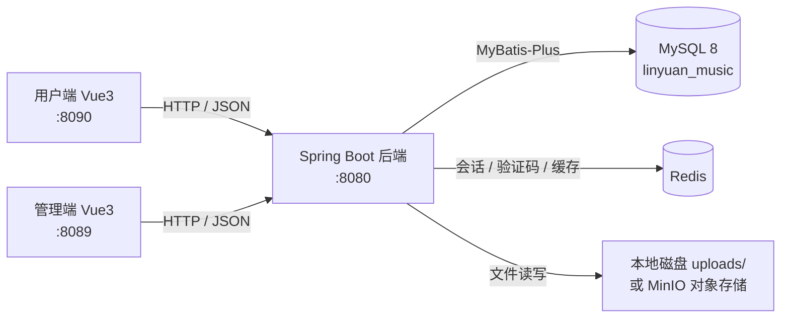
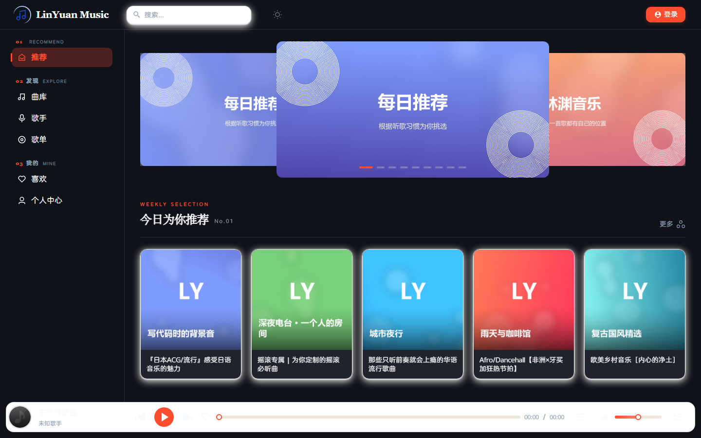
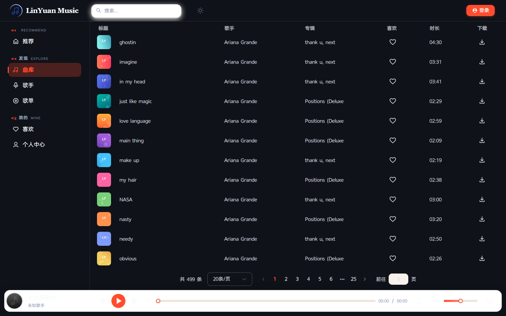
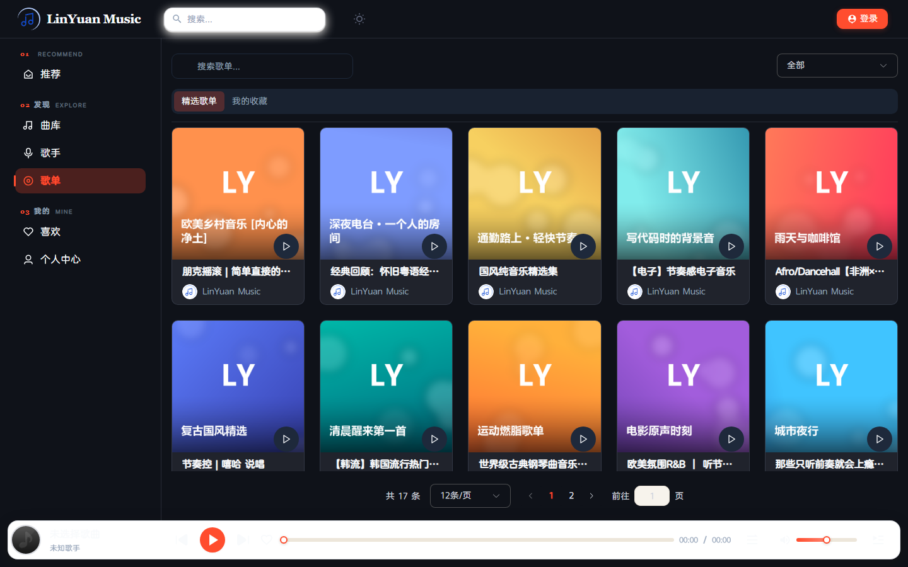
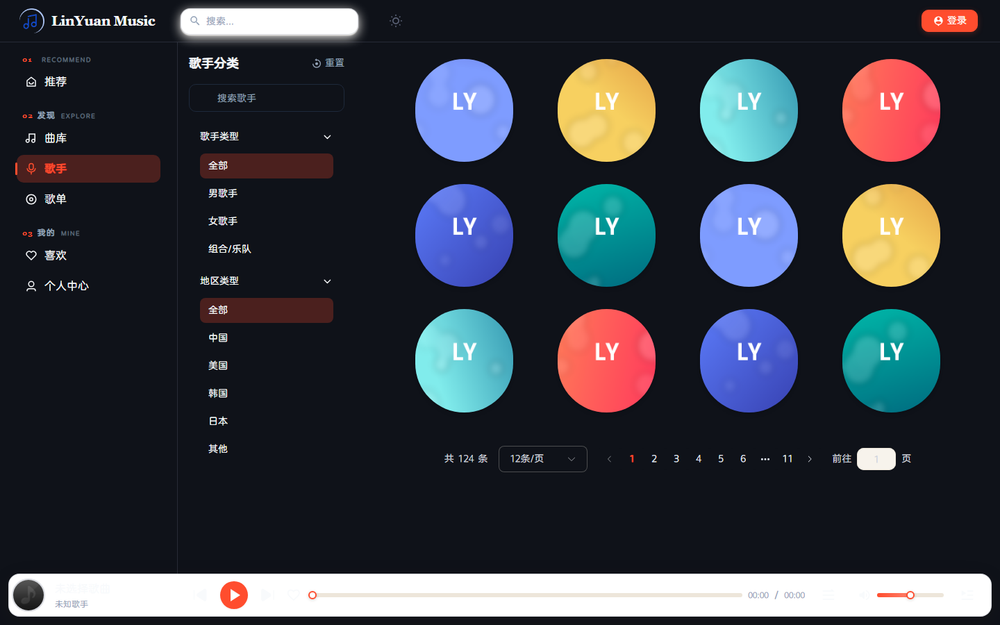
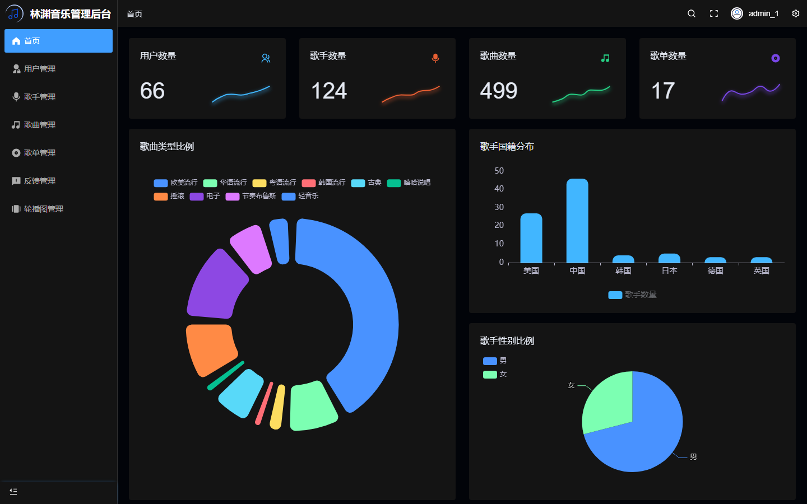
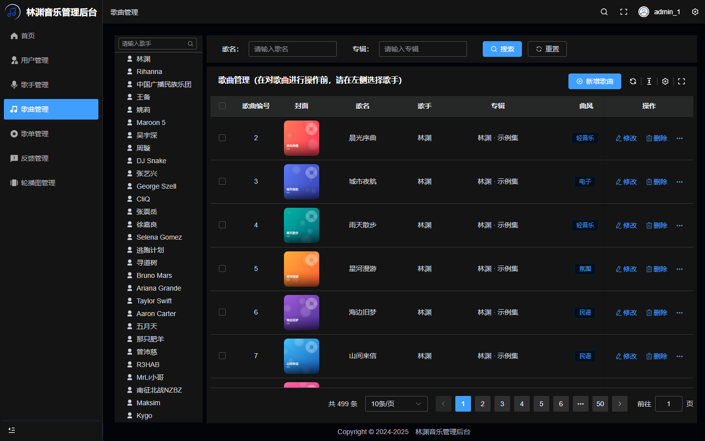

<div align="center">
  
  <h1>林渊音乐 · LinYuan Music</h1>
  <p>前后端分离的在线音乐平台 · Spring Boot 3 + Vue 3</p>

  
  
  
  
  
  
</div>

---

## 项目简介

林渊音乐是一个**前后端分离的在线音乐平台**，包含三部分：

| 模块 | 说明 | 技术 |
| --- | --- | --- |
| `linyuan-music-backend` | 后端服务（Maven 多模块，可打 fat jar） | Spring Boot 3.5、Java 17、MyBatis-Plus、MySQL、Redis、JWT |
| `linyuan-music-client` | 用户端音乐播放器 | Vue 3、TypeScript、Vite 6、Pinia、Element Plus、Tailwind CSS、Artplayer |
| `linyuan-music-admin` | 后台管理系统 | Vue 3、TypeScript、Element Plus、ECharts（基于 vue-pure-admin 精简） |

用户可以在线浏览、搜索、播放、收藏、评论音乐；管理员可以在后台维护用户、歌手、歌曲、歌单、轮播图和用户反馈，并查看数据看板。

> 示例数据：499 首歌曲、123 位歌手、17 个歌单、66 个用户；其中 10 首内置了可播放的示例音频，开箱即可体验完整流程。

## 功能特性

### 用户端

- 首页推荐：轮播图、推荐歌单、推荐歌曲
- 曲库：分页浏览 + 按歌名 / 歌手 / 专辑搜索
- 歌手、歌单详情页，歌曲播放（Artplayer，支持进度、音量、上一首/下一首、循环模式）
- 用户注册 / 登录 / 找回密码（JWT + 邮箱验证码）
- 收藏歌曲、收藏歌单、点赞与评论
- 个人中心：资料修改、头像上传
- 暗黑模式切换

### 管理端

- 数据看板：用户 / 歌手 / 歌曲 / 歌单总量，歌曲风格分布、歌手国籍与性别分布（ECharts）
- 用户管理：分页查询、启用 / 禁用、编辑、删除
- 歌手管理：新增 / 修改 / 删除、头像上传
- 歌曲管理：按歌手维度管理、封面上传、音频上传
- 歌单管理：封面、歌单内歌曲维护
- 轮播图管理、用户反馈处理

### 后端

- **统一响应结构** `Result<T>` / `PageResult<T>` + 全局异常处理
- **JWT 认证** + Redis 会话校验 + 基于角色的路径权限拦截器（`ROLE_ADMIN` / `ROLE_USER`）
- **Redis**：登录会话、邮箱验证码（5 分钟）、热门歌曲 / 用户信息缓存
- **文件存储抽象**：`local`（默认，存本地磁盘）与 `minio`（对象存储）两种实现，配置文件一键切换
- **邮件服务**：注册 / 找回密码验证码
- 参数校验（Jakarta Validation）、分页插件（MyBatis-Plus Page）、Druid 连接池

## 技术栈

| 层次 | 技术 |
| --- | --- |
| 后端框架 | Spring Boot 3.5.16、Spring MVC、Java 17、Maven 多模块 |
| 持久层 | MyBatis-Plus 3.5.9（分页、LambdaQuery）、Druid 1.2.24、MySQL 8 |
| 缓存 / 会话 | Redis（Spring Data Redis / Lettuce）、Spring Cache |
| 安全 | JWT（java-jwt 4.4）、路径级角色权限、参数校验 |
| 文件存储 | 本地磁盘（默认）/ MinIO 8.5.9 |
| 邮件 | Jakarta Mail（SMTP + SSL） |
| 前端 | Vue 3.5、TypeScript、Vite 6、Pinia、Element Plus、Tailwind CSS、Artplayer |
| 管理端 | vue-pure-admin 精简版、ECharts |
| 构建 | pnpm（前端）、Maven Wrapper（后端） |

## 系统架构



请求链路：`Controller → Service → Mapper → MySQL`，统一由 `LoginInterceptor` 做 JWT 鉴权与角色路径校验，`GlobalExceptionHandler` 兜底异常，返回 `Result<T>`。

## 项目结构

```
linyuan-music/
├── linyuan-music-backend/                 # 后端（Maven 多模块）
│   ├── linyuan-music-common/              # 通用：Result、常量、枚举、JWT 工具
│   ├── linyuan-music-model/               # 数据模型：entity / dto / vo
│   ├── linyuan-music-server/              # 主应用：controller / service / mapper / config
│   │   └── src/main/resources/
│   │       ├── application.yml            # 公共配置
│   │       ├── application-dev.example    # 本地配置模板（复制为 application-dev.yml）
│   │       └── mapper/*.xml               # 复杂查询 SQL
│   └── uploads/                           # 本地文件存储目录（示例数据已内置）
├── linyuan-music-client/                  # 用户端前端
├── linyuan-music-admin/                   # 管理端前端
├── sql/linyuan_music.sql                  # 建表 + 示例数据
├── docs/                                  # 部署、接口文档与截图
└── docker-compose.yml                     # 一键启动 MySQL + Redis（可选）
```

## 界面预览

| 用户端首页 | 曲库 |
| --- | --- |
|  |  |

| 歌单 | 歌手 |
| --- | --- |
|  |  |

| 管理端看板 | 歌曲管理 |
| --- | --- |
|  |  |

更多截图见 [`docs/screenshots`](./docs/screenshots)。

## 快速开始

### 1. 环境要求

- JDK 17、Maven（项目自带 `mvnw`，无需单独安装 Maven）
- Node.js ≥ 18、pnpm ≥ 9
- MySQL 8、Redis（**MinIO 可选**，默认使用本地磁盘存储）

### 2. 初始化数据库

```bash
# 创建数据库
mysql -u root -p -e "CREATE DATABASE linyuan_music CHARACTER SET utf8mb4 COLLATE utf8mb4_0900_ai_ci;"

# 导入建表语句与示例数据
mysql -u root -p --default-character-set=utf8mb4 linyuan_music < sql/linyuan_music.sql
```

### 3. 启动 Redis

```bash
redis-server            # 默认 127.0.0.1:6379，无密码即可
```

也可以用 `docker compose up -d` 一并启动 MySQL 与 Redis（见 `docker-compose.yml`）。

### 4. 启动后端

```bash
cd linyuan-music-backend

# 复制配置模板并修改：MySQL / Redis 账号密码
cp linyuan-music-server/src/main/resources/application-dev.example \
   linyuan-music-server/src/main/resources/application-dev.yml

./mvnw spring-boot:run -pl linyuan-music-server      # Windows: mvnw.cmd spring-boot:run -pl linyuan-music-server
```

启动后接口地址为 <http://localhost:8080>。

> 注意：`uploads/` 是相对**启动目录**的路径，建议在 `linyuan-music-backend/` 下启动，示例音频与封面才能被正确访问。

### 5. 启动用户端 / 管理端

```bash
cd linyuan-music-client && pnpm install && pnpm dev     # http://localhost:8090
cd linyuan-music-admin  && pnpm install && pnpm dev     # http://localhost:8089
```

后端地址通过环境变量配置（默认 `http://localhost:8080`）：

- 用户端：`.env.development` 中的 `VITE_APP_BASE_API`
- 管理端：`.env.development` 中的 `VITE_APP_BASE_API`

### 6. 演示账号

| 角色 | 账号 | 密码 |
| --- | --- | --- |
| 管理端 | `admin` | `abc12345` |
| 用户端（邮箱登录） | `linyuan@example.com` | `abc12345` |

## 配置说明

`application.yml` 中的敏感配置通过 `linyuan-music.*` 占位符注入，本地配置写在被 Git 忽略的 `application-dev.yml` 中：

```yaml
linyuan-music:
  datasource:
    url: jdbc:mysql://localhost:3306/linyuan_music?useUnicode=true&characterEncoding=utf-8&useSSL=false&serverTimezone=Asia/Shanghai&allowPublicKeyRetrieval=true
    username: root
    password: 你的密码
  redis:
    host: localhost
    port: 6379
    password:
  storage:
    type: local            # local：本地磁盘（默认）；minio：对象存储
    local-dir: ./uploads
    url-prefix: /files
    public-base-url: http://localhost:8080/files
  mail:                    # 仅注册/找回密码发送验证码时使用，可留空
    host: smtp.qq.com
    username: your@qq.com
    password: 授权码
```

切换到 MinIO：

```yaml
linyuan-music:
  storage:
    type: minio
    public-base-url: http://localhost:9000/linyuan-music-data
  minio:
    endpoint: http://localhost:9000
    accessKey: minioadmin
    secretKey: minioadmin
    bucket: linyuan-music-data
```

## 接口一览

| 模块 | 方法 | 路径 | 说明 |
| --- | --- | --- | --- |
| 认证 | POST | `/user/login` | 用户登录（邮箱 + 密码） |
| 认证 | POST | `/admin/login` | 管理员登录 |
| 用户 | GET | `/user/getUserInfo` | 当前用户信息 |
| 用户 | PUT | `/user/updateUserInfo` | 修改资料（含头像上传） |
| 歌曲 | POST | `/song/getAllSongs` | 分页查询 / 搜索歌曲 |
| 歌曲 | GET | `/song/getRecommendedSongs` | 推荐歌曲 |
| 歌曲 | GET | `/song/getSongDetail/{id}` | 歌曲详情 |
| 歌手 | POST | `/artist/getAllArtists` | 分页查询歌手 |
| 歌单 | POST | `/playlist/getAllPlaylists` | 分页查询歌单 |
| 歌单 | GET | `/playlist/getPlaylistDetail/{id}` | 歌单详情 |
| 收藏 | POST | `/favorite/getFavoriteSongs` | 我收藏的歌曲 |
| 收藏 | POST | `/favorite/collectSong` | 收藏 / 取消收藏 |
| 评论 | POST | `/comment/addSongComment` | 发表歌曲评论 |
| 管理 | POST | `/admin/getAllUsers` | 用户列表（管理员） |
| 管理 | POST | `/admin/addSong` | 新增歌曲（含音频上传） |

完整接口见 [docs/接口文档.md](./docs/接口文档.md)。

## 数据库设计

共 12 张表，统一使用 `tb_` 前缀：

`tb_user`（用户）、`tb_admin`（管理员）、`tb_artist`（歌手）、`tb_song`（歌曲）、`tb_playlist`（歌单）、`tb_playlist_binding`（歌单-歌曲关联）、`tb_genre`（流派）、`tb_style`（风格）、`tb_banner`（轮播图）、`tb_comment`（评论）、`tb_user_favorite`（收藏）、`tb_feedback`（反馈）。

## 本地验证记录

- 后端 `mvnw clean package` 构建通过，`java -jar` 启动成功（8080）
- 用户端 / 管理端 `pnpm dev` 启动，登录、列表、分页、上传、图表均正常
- 示例音频可正常加载播放（时长 42s）

## 部署

生产构建：

```bash
# 后端
cd linyuan-music-backend && ./mvnw clean package -DskipTests
java -jar linyuan-music-server/target/linyuan-music-server-0.0.1-SNAPSHOT.jar

# 前端
cd linyuan-music-client && pnpm build   # 产物 dist/
cd linyuan-music-admin  && pnpm build   # 产物 dist/
```

详见 [docs/部署.md](./docs/部署.md)。

## Roadmap

- [ ] 播放历史与听歌排行
- [ ] 歌词滚动与桌面歌词
- [ ] 音乐推荐算法（基于协同过滤）
- [ ] 接口文档自动化（SpringDoc / OpenAPI）

## License

本项目基于 [Alex-LiSun/vibe-music](https://github.com/Alex-LiSun) 的 MIT 协议版本二次开发，保留原始版权声明，具体见 [LICENSE](./LICENSE) 与 [NOTICE](./NOTICE)。

示例音频来自 [SoundHelix](https://www.soundhelix.com/) 提供的免费示例曲目；封面、轮播图等图片为本项目脚本生成的占位图。
